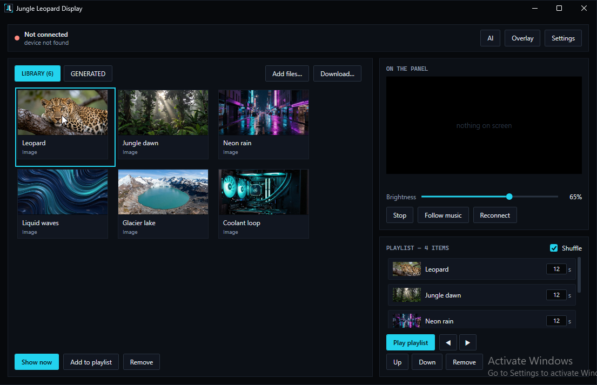
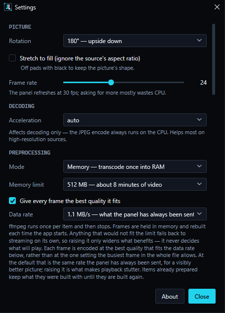
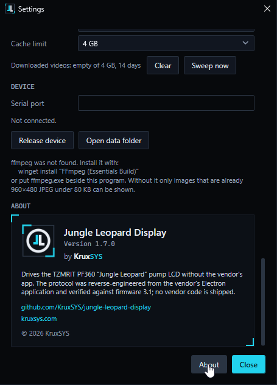
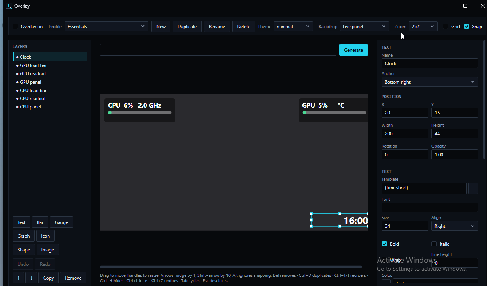

<!--
  Brand: KruxSYS palette and marks, see docs/brand.md.
  The repository address is defined once, in the [repo] / [releases] reference links at the bottom.
-->
<p align="center">
  
</p>

<h1 align="center">Jungle Leopard Display</h1>

<p align="center">
  <a href="https://kruxsys.com/"></a>
  &nbsp;by <a href="https://kruxsys.com/"><b>KruxSYS</b></a>
</p>

<p align="center"><b>Drive the TZMRIT PF360 "Jungle Leopard" pump LCD from Windows, without the vendor's app.</b></p>

<div align="center">

[][releases]
[](https://kruxsys.com/)
[][releases]
[][releases]
[](#requirements)

**[Download][releases]** · **[Docs](#documentation)** · **[kruxsys.com](https://kruxsys.com/)** · **[Source][repo]**

</div>

Jungle Leopard Display puts your pictures, videos, system statistics and whatever music you're
playing on the 960×480 LCD in the head of a TZMRIT PF360 ("Jungle Leopard") AIO cooler. It replaces
the vendor's Electron app with a small native Windows 10/11 x64 tray app and a command-line tool,
shipped as an **installer** and a **portable zip**.

*Formerly at [senesees/Jungle-Leopard-Display-TZMRIT-PF360-LCD](https://github.com/senesees/Jungle-Leopard-Display-TZMRIT-PF360-LCD).
Since 1.7.0 it is a KruxSYS product. Your library, settings and caches carry over untouched.*



## Features

- **Library and playlist.** Drag in images and videos, or fetch a video from YouTube, then show one
  or rotate through a playlist with per-image dwell times and shuffle.
- **Preprocessing.** Each video is transcoded once into panel-ready frames, at the best JPEG quality
  each frame can afford within a data rate the panel can keep up with. After that, playback runs with
  no ffmpeg at all. [More](docs/preprocessing.md)
- **Overlays.** Clocks, CPU/GPU load and temperatures, graphs, gauges, images and text, composited
  live over whatever is playing. They're built in a canvas editor with undo, or described in a sentence
  to a local AI model. [More](docs/overlays.md)
- **Follow what's playing.** Mirrors the music playing elsewhere on the machine (a YouTube Music tab,
  a desktop player): the music video when one can be found, a now-playing card when not.
  [More](docs/music.md)
- **AI image pipeline** (optional). Generates a stream of images with your own SwarmUI server and puts
  them on the panel. [More](docs/ai-pipeline.md)
- **Stays out of the way.** It lives in the notification area, can start when you sign in, survives
  sleep and wake, and reconnects when the panel comes back.
- **A command-line tool** for scripting and one-shot use, on the same native core.

| Settings | About |
|---|---|
|  |  |
| **Overlay editor** | **An overlay on the panel** |
|  |  |

*Screenshots of the app were taken with no panel attached, which is why the preview is empty. The
overlay image is the panel's own output.*

## Install

### Installer (recommended)

Download `JungleLeopardDisplay-<version>-win-x64-setup.exe` from [Releases][releases] and run it.

- It installs **for your account only**, into `%LOCALAPPDATA%\Programs\Jungle Leopard Display`, with no
  admin prompt. Choose *Install for all users* in the first dialog to install into Program Files
  instead (that one asks for admin).
- It adds a Start menu entry, an optional desktop icon and an entry in *Settings → Apps*.
- If the **.NET 9 Desktop Runtime** or **ffmpeg** is missing, it says so and gives the download link
  and the `winget` command. Neither is bundled.

The installer is **not code-signed**, so Windows SmartScreen may warn the first time. Choose
*More info → Run anyway*.

### Portable

Download `JungleLeopardDisplay-<version>-win-x64-portable.zip`, unzip it anywhere and run
`JungleLeopardDisplayManager.exe`. It writes no registry keys and needs nothing installed beyond the
[requirements](#requirements).

### Update

Run the new installer over the old one, or replace the portable folder's files. The installer closes a
running manager first. Your data stays where it was in either case.

### Uninstall

Use *Settings → Apps → Jungle Leopard Display → Uninstall* (or delete the portable folder). The
uninstaller also removes the "Start when I sign in" task. Your library, playlist, settings and
overlays in `%LOCALAPPDATA%\JungleLeopardDisplay`, and preprocessed frames in
`%LOCALAPPDATA%\jl_display`, are **kept**. Delete those folders to remove them too.

## Requirements

| | |
|---|---|
| **OS** | Windows 10/11, **x64 only** |
| **Runtime** | [.NET 9 Desktop Runtime](https://dotnet.microsoft.com/download/dotnet/9.0) (`winget install Microsoft.DotNet.DesktopRuntime.9`), for the manager only; the CLI is native |
| **ffmpeg** | `winget install "FFmpeg (Essentials Build)"`, or drop `ffmpeg.exe` beside the binaries |
| **Panel** | TZMRIT PF360 / "Jungle Leopard", verified against firmware **3.1**, model `TXW818-ST7701S-5.5inch-hor` |

ffmpeg does all transcoding. Without it, the only thing that can be displayed is an image that is
*already* a 960×480 JPEG under 80 KB. `ffprobe` is optional. Without it, calibration reports elapsed
time instead of progress.

> **Only one process can hold the panel at a time.** Close the vendor app before using either program,
> and don't run the CLI and the manager together. The manager has a **Release device** button for
> exactly this.

## Usage

### The manager

Start **Jungle Leopard Display** from the Start menu. It finds the panel by hardware ID, connects, and
sits in the notification area.

- **Add files…**, or drag images and videos onto the window.
- **Download…** takes a YouTube URL and fetches the video into the library. `yt-dlp.exe` ships beside
  the manager, so nothing needs installing first.
- Select an item and **Show now**, or double-click it.
- **Add to playlist** to build a rotation, then **Play playlist**. Stills hold for their dwell in
  seconds; videos play through and hand over.
- **Overlay** opens the editor; the tray menu switches overlays on and off.
- **Follow music** mirrors whatever is playing elsewhere on the machine.
- Closing the window hides it, and the panel keeps running. **Exit** on the tray menu is the only thing
  that stops it.

New videos are calibrated in the background as they're added, so pressing Show later is instant.

**Settings.** **Rotation** compensates for however the pump head ended up mounted. It rotates 270° on
its magnet and there is no device-side rotation command, so this is done host-side (as the vendor app
does). **Start when I sign in** registers a logon-triggered scheduled task rather than a `Run` key,
which buys restart-on-failure and no "stop on battery". The checkbox reads the real registered state,
so removing the task outside the app is reflected honestly. **Preprocessing** decides whether ffmpeg
runs for as long as something is on the panel, or only once per item; see
[Preprocessing](docs/preprocessing.md). **About** shows the version and links.

### The command line

```
Jungle Leopard Display.exe [--port COMn] [--rotate 0|90|180|270] [--stretch]
    --info
    --light 0-100
    --image FILE [--once]
    --video FILE [--loop] [--fps N] [--quality 2-31]
                 [--recalibrate] [--hwaccel auto|d3d11va|cuda|qsv]
                 [--preprocess none|memory|disk] [--limit MB]
                 [--per-frame] [--ceiling 50-98] [--rate KB/s]
    --clear-cache
```

```sh
# what's attached?
"Jungle Leopard Display.exe" --info

# a still, held until Ctrl-C (the panel drops out of live mode without a keepalive)
"Jungle Leopard Display.exe" --image photo.jpg

# send one frame and exit, screen mounted upside down
"Jungle Leopard Display.exe" --image photo.jpg --rotate 180 --once

# loop a clip
"Jungle Leopard Display.exe" --video clip.mp4 --loop

# transcode it once, then loop it forever with no ffmpeg running
"Jungle Leopard Display.exe" --video clip.gif --loop --preprocess disk

# best quality each frame can afford, rather than one figure for the whole file
"Jungle Leopard Display.exe" --video clip.mp4 --preprocess disk --per-frame

# the same, allowed a higher data rate - watch the panel, this is what stutters
"Jungle Leopard Display.exe" --video clip.mp4 --preprocess disk --rate 1400

# same, but cap the pack cache at 2 GB (--limit applies to whichever mode is set)
"Jungle Leopard Display.exe" --video clip.gif --loop --preprocess disk --limit 2048
```

Without `--once`, `--image` holds live mode until interrupted. `--stretch` fills the panel and ignores
aspect ratio; the default pads with black.

`--hwaccel` affects **decoding only**. There is no GPU MJPEG encoder on NVENC or AMF (Intel's
`mjpeg_qsv` is the lone exception), so the encode stays on the CPU either way. It pays off on
high-resolution sources, where decoding dominates; on small inputs the extra GPU↔system copies can make
it slower than plain software.

## Documentation

| Page | What's in it |
|---|---|
| [Preprocessing](docs/preprocessing.md) | Packs, the memory and disk caches, per-frame quality and the data rate |
| [Overlays](docs/overlays.md) | Layers, themes, describing an overlay in words, sensors, the size budget |
| [Following what's playing](docs/music.md) | The media session, finding the video, sync |
| [AI image pipeline](docs/ai-pipeline.md) | SwarmUI, prompt enhancement, where images go, keys |
| [How it works](docs/architecture.md) | Architecture, the native API, where data is stored, the repository layout |
| [Protocol notes](docs/protocol.md) | The panel's serial protocol, recovered from the vendor app |
| [Troubleshooting](docs/troubleshooting.md) | Common problems, and known rough edges |
| [Brand](docs/brand.md) | The KruxSYS colours, type and marks this app uses |
| [Audit, 1.7.0](docs/audit-1.7.0.md) | Every finding of the 1.7.0 code review and what was done about it |

## Building

Requires **Visual Studio 2022** (v143 toolset, C++ and .NET desktop workloads) and the **.NET 9 SDK**.

```sh
msbuild "Jungle Leopard Display.sln" -p:Configuration=Release -p:Platform=x64 -restore
```

Everything that ships lands in `x64\Release\`, native and managed together, so `DllImport` resolves
with no probing paths. The two test projects build into `test-out\` and never into the drop:

```sh
test-out\x64\Release\JLDisplayCore.Tests.exe                 # native core, no device needed
dotnet test test-out\managed\JLDisplayManager.Tests.dll      # manager logic, theme, interop
```

Release builds emit **no PDBs**: `DebugInformationFormat` is `None` and `GenerateDebugInformation` is
`false` for every Release configuration, and the manager sets `DebugType=none`. Debug configurations
keep their symbols, though the solution maps `Debug|x64` onto `Release|x64` for every project, so a
plain solution build never produces any. Native code builds clean at `/W4`.

The icons and installer art are generated from `assets/brand/*.svg` by `python3 tools/make_icons.py`
(Inkscape and Pillow). The outputs are committed, so building never needs Python.

## Releasing

```powershell
powershell -ExecutionPolicy Bypass -File tools\release.ps1
```

Needs, in addition to the above, [Inno Setup](https://jrsoftware.org/isinfo.php) 6.6 or later. One
command:

1. checks that `<Version>` in `JLDisplayManager.csproj` and `JLDisplayCore\jl_version.h` agree,
2. rebuilds Release x64 from clean and stops on any warning,
3. runs both test suites,
4. stages exactly the shipped files and writes `dist\JungleLeopardDisplay-<version>-win-x64-setup.exe`
   and `dist\JungleLeopardDisplay-<version>-win-x64-portable.zip`.

To cut a release: bump both version numbers, add `dist\RELEASE-NOTES-<version>.md`, run the script, and
attach the two files to a GitHub release.

## Architecture

```
JLDisplayCore   (static lib)  protocol · device I/O · ffmpeg · calibration · packs · overlay compositing
  │
  ├── Jungle Leopard Display.exe    thin CLI (single self-contained exe)
  │
  └── JLDisplayNative.dll         flat C API, async workers
            │
            └── JungleLeopardDisplayManager.exe   WPF tray app (net9.0-windows, P/Invoke)
```

The core is static, so the CLI stays one exe; the DLL exists only to give C# something to P/Invoke.
Nothing blocks the UI: every content call starts a native worker and returns, and the manager polls a
status struct every 250 ms. Overlays are drawn by the manager and composited natively into every
frame. See [How it works](docs/architecture.md) for the rest, including where data is stored.

## Other KruxSYS projects

- **[Plexdio](https://github.com/KruxSYS/plexdio)**: a small, native Windows music player for Plex.
  [plexdio.kruxsys.com](https://plexdio.kruxsys.com) · [project page](https://kruxsys.com/projects/plexdio/)
- **[Krunk](https://krunk.kruxsys.com)**: a fast, private web browser for Windows, Android and Android TV.
  [krunk.kruxsys.com](https://krunk.kruxsys.com) · [project page](https://kruxsys.com/projects/krunk/)

More at [kruxsys.com](https://kruxsys.com/).

## Credit

Protocol reverse-engineered from the vendor Electron application (`resources/app.asar`,
`main/_baseClass/device.js`) and verified against firmware 3.1. This project ships no vendor code.

## Donations

BTC
```
bc1q3evq9z0scme5repkz5gmsza3tyfeaqwfqx8xa7trnjmh7a7yk8ts55xgfv
```

---

<p align="center">© 2026 KruxSYS</p>

[repo]: https://github.com/KruxSYS/jungle-leopard-display
[releases]: https://github.com/KruxSYS/jungle-leopard-display/releases
