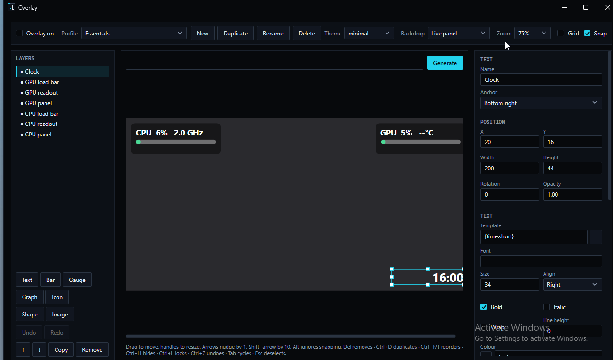

# Overlays

*Part of the [Jungle Leopard Display](../README.md) documentation. Moved out of the README in 1.7.0, unchanged.*

System statistics drawn on top of whatever is playing — CPU load, temperatures,
clocks, network rates, a clock — as layers you arrange yourself, or describe in a
sentence and let a model build.

The panel has no overlay plane and no alpha, so there is nothing to composite
*onto*. Every frame is decoded, blended and re-encoded on the way past. That
costs about 2 ms and it is why the overlay is a feature of the player rather
than something bolted alongside it.

The re-encode answers to the **same data rate** the pack builder does. That is
worth saying because it did not always: the compositor used to steer on the
80 KB per-frame cap instead, which works out to well over twice the default
rate, and an overlay could quietly push a stream from 1.1 MB/s to 1.7 MB/s.
Nothing reported it — the panel accepts every byte and falls behind in silence
— so it showed up only as a picture that hitched with the overlay on and not
without it. If you turn the overlay on and the picture softens slightly, that
is this working: the rate is fixed, so the overlay's bytes have to come from
somewhere.

## Layers

**Overlay** — on the tray menu, or the button in the main window — opens the
editor.

A profile is a stack of layers
over the 960×480 surface, each anchored to a corner, edge or the centre so a
readout pinned bottom-right stays there.

| Layer | What it draws |
|---|---|
| **Text** | A template — `CPU {cpu.load:0}%  {cpu.temp:0}°C` — resolved live |
| **Bar** | A level bar, continuous or segmented |
| **Gauge** | A circular dial with a number in the middle |
| **Graph** | A sparkline of the last minute: line, area or columns |
| **Icon** | One symbol from the icon font Windows already ships |
| **Shape** | A backing card, a divider, or ornament — brackets, rings, arcs |
| **Image** | A file you pick, copied into the profile's assets |

Drag to move, drag the handles to resize, and the properties pane on the right
edits everything else. Hold **Alt** while dragging to bypass snapping; arrow
keys nudge a pixel at a time, or ten with **Shift**. **Ctrl+Z** undoes, back a
hundred steps and including a deleted profile. The
canvas draws against the real live frame, in the orientation the panel is
actually mounted — you edit what you will see, not a mirror of it.

A **theme** — minimal, hud, terminal or neon — sets the palette, the fonts and
the corner style for the whole profile. Layer colours are role names (`good`,
`warm`, `track`, `panel`) rather than hex codes, so switching theme restyles
everything coherently instead of leaving half of it behind. A literal `#RRGGBB`
still works and is left alone.

## Describing one instead

With an LLM configured under **Settings → AI**, the editor's prompt box takes
a sentence:

- *"Add a clock at the center"*
- *"Add GPU usage bottom left"*
- *"Make a HUD style overlay with CPU and GPU"*
- *"Show me a CPU usage graph"*
- *"Give me a neon overlay with glowing text and shaded panels"*

The model returns a compact plan — kinds, sensors, anchors, sizes — and the app
turns that into real layers: it resolves sensor ids against what this machine
actually has, fills in colours from the theme, and runs its own layout pass so
nothing overlaps or falls off the panel. **The model never writes pixel
coordinates or colours.** That division is deliberate; it is what makes a small
local model reliable enough to be useful here.

Nothing is applied until you accept it. The result banner says what changed,
**Try again** re-rolls, and **Discard** puts back exactly what was there
including the theme.

Sensors that are unavailable draw `--` rather than a misleading zero, and a
prompt naming a sensor this machine does not have is told so rather than
silently producing a dead layer.

## Where the numbers come from

| Source | Gives |
|---|---|
| **PDH** (built in) | CPU load per core, memory, disk, network rates |
| **NVML** (built in) | NVIDIA load, temperature, clocks, VRAM, power, fan |
| **LibreHardwareMonitor** | CPU package temperature, motherboard fans, voltages |
| **HWiNFO** | the same, if you already run it |

The first two need nothing installed. **CPU temperature is the exception** —
Windows exposes no such counter, so it needs LibreHardwareMonitor (enable its
web server, default port 8085) or HWiNFO with shared memory support enabled.
Both are opt-in under **Settings → Sensors**, which shows what actually
connected and how many sensors matched.

Readings are smoothed so bars glide instead of twitching; templates can ask for
the raw figure instead.

## The size budget

Every frame still has to fit the panel's 80 KB ceiling after the overlay is
blended in. Measured over a range of backdrops, a heavy 10-layer overlay reaches
about 78% of the cap on the hardest frame and the quality loop never engages —
so in practice the overlay costs no picture quality at all. What costs is layer
*count*, not which effects you use; the difference between an outline, a glow
and a pill is around a kilobyte.

---

[Back to the README](../README.md)
